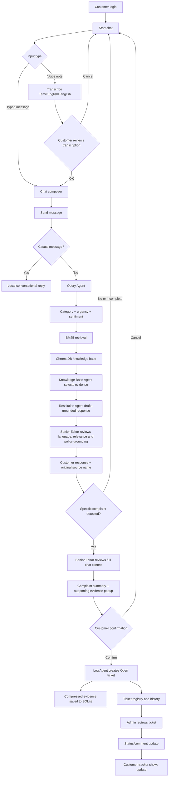

# AI Customer Support Desk

A customer-support demo for the Social Eagle AI Engineering assignment. It provides a Streamlit customer chat, evidence-aware complaint handling, an admin ticket console, and a persistent document-grounded knowledge base. The normal workflow is:

`Customer message → Query Agent → BM25/ChromaDB Knowledge Agent → Resolution Agent → Senior Editor → Customer response`

Complaint registration is a separate confirmed workflow:

`Chat history + evidence → Senior Editor complaint summary → Customer confirmation → Log Agent → Ticket registry → Admin/customer tracker`

## AutoGen orchestration

The project uses a **controlled sequential AutoGen workflow**. Each agent is invoked once in a fixed order—Query Agent, Knowledge Base Agent, Resolution Agent, and Senior Editor. The Log Agent performs deterministic ticket recording after customer confirmation. This implementation does not use `RoundRobinGroupChat`, `SelectorGroupChat`, `Swarm`, or `MagneticOne` because customer-support routing requires predictable order, bounded calls, clear guardrails, and no autonomous loop between agents.

The initial RAG source is the supplied Help and Customer Service DOCX in `Input/`. The ingestion layer extracts DOCX text, tables, and hyperlinks, optionally crawls linked pages, and persists the knowledge base in ChromaDB. BM25 JSON retrieval remains as a local fallback if the vector-store dependency or embedding model is unavailable.

## Run locally from CMD

The project virtual environment is created locally from **Command Prompt (CMD)** in the project folder.

```cmd
python -m venv venv
venv\Scripts\activate
pip install -r requirements.txt
streamlit run app.py
```

Copy `.env.example` to `.env` and configure `OPENAI_API_KEY`. AutoGen is mandatory for every non-casual support request; the application does not silently switch to a deterministic answer when the key or provider is unavailable.

## Demo login credentials

These credentials are dummy assignment data only:

| Login | Value |
|---|---|
| Customer 1 mobile | `9999` |
| Customer 2 mobile | `8888` |
| Password for both customers | `0000` |
| Admin password | `admin123` |

The demo user profile is also retained. Do not use these credentials in a real system.

For this assignment, the demo customer profiles and passwords are hardcoded in the local Python user store. They are dummy credentials used only for smoke testing and demonstration; they are not production authentication secrets.

## End-to-end workflow

1. The customer logs in with mobile number and password. The customer sees only the customer navigation and starts with a fresh chat.
2. The customer sends typed text, Tamil, English, Tanglish, attachments, or a voice note. Voice transcription is a human-in-the-loop step: transcription opens for review, and only OK places the edited text in the composer. Agent processing starts only when the customer presses Send.
3. Casual greetings and microphone checks are handled locally without consuming the RAG/agent workflow.
4. The Query Agent identifies category, urgency, sentiment, and a short issue summary. Sentiment is classified as Angry, Frustrated, Neutral, or Happy and shown as a 0–5 rating.
5. The Knowledge Base Agent searches the indexed documents using BM25 retrieval and the persistent ChromaDB knowledge base. Only relevant passages are passed forward. Source document names remain visible in their original form.
6. The Resolution Agent drafts a concise, grounded answer. It asks focused clarification questions when the requirement is unclear and requests proportionate evidence: payment screenshots, product photos/bills, or order/refund proof when applicable.
7. The Senior Editor reviews the draft against the complaint, evidence, and language. It removes policy dumping, irrelevant content, unsupported promises, literal translations, and unrelated chat content. Responses are restricted to Tamil, English, or Tanglish.
8. When the customer provides a sufficiently specific complaint, the workflow automatically opens the complaint-review popup after the support response. The customer does not need to manually start a separate complaint page. The Senior Editor reviews the complete current conversation—not only the last message—and creates a crisp complaint summary. Incomplete messages remain in chat and receive a clarification question.
9. The complaint summary and supporting documents appear in a review popup. The customer can edit, cancel, or confirm. No ticket is created before confirmation.
10. After confirmation, the Log Agent records the ticket, status, customer, category, urgency, sentiment, response, source documents, escalation reason, and updates. The default complaint status is Open.
11. The customer receives the ticket number and can track status, sentiment, support updates, comments, and compressed evidence. Admins can update status to Open, In Progress, Closed, Rejected, or Cancelled and add customer-visible comments.

### End-to-end workflow chart



## Knowledge base and BM25 RAG

Admin Knowledge Management accepts DOCX, PDF, XLSX/XLSM, TXT, and Markdown files. DOCX hyperlinks can be crawled and a direct-link report is generated when a link cannot be opened. Indexed Documents displays the filename, analysed status, upload time, and delete action.

The index is rebuilt from all files in `input/` and `knowledge_base/uploads/`; uploading a new file does not erase existing documents. SHA-256 content deduplication prevents the same document from being embedded more than once, even if it has a different filename or exists in both folders. BM25 retrieval provides the local lexical fallback, while ChromaDB stores the persistent searchable embeddings.

## Safety, guardrails, and observability

- Input, output, timeout, retry, token, and maximum-agent-call limits prevent runaway usage.
- Structured JSON output is validated for category, urgency, sentiment, confidence, and response content.
- Unsupported languages/scripts are rejected; supported response languages are Tamil, English, and Tanglish.
- Responses are grounded in retrieved evidence and display the original source document names.
- High-risk billing disputes, angry/high-urgency requests, missing evidence, no matching policy, legal threats, and low-confidence cases can be escalated.
- All dates and timestamps use current IST (`Asia/Kolkata`), not model training dates.
- LangSmith usage tracing is supported when configured; local usage totals are shown in Admin Knowledge Management. Provider credit balance itself is not available through this demo.

## Storage

- Customer chat messages and compressed attachments: `logs/support_history.sqlite3`.
- Complaint registry and assignment CSV export: `logs/tickets.csv`.
- BM25 index manifest and source list: `knowledge_base/bm25_index.json`.
- ChromaDB persistent store: `knowledge_base/chroma_db/`.
- API usage tracking: `logs/api_usage.csv`.

## Admin knowledge base

Choose `Admin knowledge base` in the sidebar and enter the assignment demo password (`admin123`, or `ADMIN_PASSWORD` from `.env`). Admins can upload DOCX, PDF, XLSX/XLSM, TXT, and Markdown files, then rebuild the ChromaDB index. When DOCX hyperlinks cannot be fetched, the crawl report still lists the direct URLs so a client can open them manually.

## Features

- Four focused AutoGen agent modules with clear input/output boundaries.
- Grounded responses from `knowledge_base/` with source filenames.
- Customer responses display the source document names used for the answer.
- Escalation for high urgency, angry sentiment, missing evidence, legal/fraud/payment disputes, or low confidence.
- CSV ticket log with all required assignment columns.
- Normal chat is stored as conversation history; a specific complaint automatically opens the review step, but a ticket is created only after the customer confirms the complaint summary.
- Guardrails for input size, output size, API timeout, retry count, maximum agent calls, and structured-output validation.
- All ticket timestamps and date-sensitive prompts use current `Asia/Kolkata` time (IST), not model training dates or host timezone.
- Offline evaluation cases with category and escalation accuracy in `evaluation_results.csv`.

## Evaluate and test from CMD

Open **Command Prompt** in the project folder and activate the local virtual environment:

```cmd
venv\Scripts\activate
```

The evaluation is a smoke test for the six default customer-support questions in `evaluation.py`. It checks category, urgency, sentiment, final status (`Resolved` or `Escalated`), source grounding, non-empty response, valid confidence, and an overall pass result. The questions cover shipping, refund, account login, product replacement, high-risk billing, and a no-matching-document request.

```cmd
python evaluation.py
```

Run the automated regression tests from the same CMD window:

```cmd
python -m pytest -q
```

The test suite additionally checks billing urgency and angry sentiment, BM25 knowledge-source retrieval, no-evidence resolution behavior, ticket escalation logging, input-size guardrails, Tanglish payment classification, and unsupported-language rejection.

See [docs/architecture.md](docs/architecture.md) for the workflow and safety boundaries. Before submission, capture the demo screens listed in `screenshots/README.md`.

## Submission checklist

- Keep `.env` private; commit only `.env.example`.
- Rebuild ChromaDB after uploading or changing source files.
- Review failed links in the admin crawl report.
- Run `python evaluation.py` and `python -m pytest -q` from the activated `venv` in CMD before publishing.
- Include resolved, escalated, dashboard, admin, and human-review screenshots.
- The evaluation includes six reference scenarios plus project tests for Tanglish payment classification and unsupported-language rejection.
- Capture and add at least two extra test screenshots to `screenshots/`, for example `tanglish_billing.png` and `language_guardrail.png`, then include them in the final submission.
